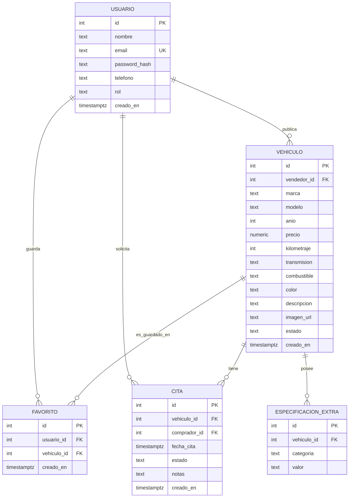

# PRD · Plataforma de Venta de Carros Usados

> Documento de requisitos del producto (Product Requirements Document).
> Complétalo en el Sprint 0 (historia H0.3) y pide la aprobación del profesor en un Issue.
> Cada requisito funcional (RF) se convierte en un Issue con la plantilla "Historia de usuario".

| Campo               | Valor                                        |
| ------------------- | -------------------------------------------- |
| Alumno              | José Miguel Galvis Monasterio                |
| Proyecto n.º        | <21>                                         |
| Sitio de referencia | <https://www.tucarro.com.ve/h/home/index-ve> |
| Compañero revisor   | <josemarc2503-sketch>                        |
| URL desplegada      | (se completa en el Sprint 5)                 |

## 1. Problema

Comprar o vender un vehículo usado suele ser un proceso pesado, desordenado e inseguro debido a publicaciones con información incompleta, dificultad para filtrar por estado mecánico o documentación, y la imposibilidad de comparar opciones lado a lado con criterios objetivos. Los compradores pierden tiempo revisando anuncios dispersos sin poder evaluar fácilmente la relación precio-kilometraje-año, mientras que los vendedores particulares y concesionarios carecen de una herramienta estructurada para gestionar su inventario y recibir consultas o reservas formales.

## 2. Usuarios

- **Usuario principal (Comprador):** Persona que busca adquirir un vehículo usado ajustado a su presupuesto y necesidades; necesita filtrar por marca, modelo, año, precio, transmisión o kilometraje, comparar hasta 3–4 vehículos simultáneamente y agendar una cita de inspección o contacto con el vendedor. Entra principalmente desde teléfono móvil (375 px) en movimiento y desde computadora (1280 px) para analizar comparativas detalladas.
- **Usuario secundario (Vendedor / Administrador de inventario):** Propietario particular o asesor de concesionario que publica vehículos con sus especificaciones técnicas y fotografías, actualiza su estado (`disponible`, `reservado`, `vendido`) y gestiona las solicitudes de cita o contacto recibidas desde computadora o móvil.

## 3. Objetivo y métrica de éxito

«Un comprador filtra el catálogo, selecciona hasta 3 carros usados y visualiza su tabla comparativa multicriterio en menos de 20 segundos, logrando agendar una cita de revisión en menos de 3 clics».

## 4. Alcance del MVP

Entre 5 y 8 funcionalidades que SÍ entran este semestre:

1. **Autenticación y roles de usuario:** Registro e inicio de sesión diferenciando compradores y vendedores/administradores.
2. **Catálogo y publicación de vehículos:** CRUD completo de vehículos usados (marca, modelo, año, precio, kilometraje, transmisión, combustible, estado legal/mecánico e imágenes) con control de disponibilidad.
3. **Búsqueda y filtrado avanzado:** Filtrado combinable por rango de precio, año, marca, kilometraje máximo, tipo de transmisión y ordenamiento por relevancia, menor precio o menor kilometraje.
4. **Comparador multicriterio (reto distintivo):** Selección de 2 a 4 vehículos para compararlos lado a lado con cálculo automático de puntuación ponderada (precio, año, kilometraje y equipamiento) y resaltado de la mejor opción por criterio.
5. **Lista de favoritos (Garage guardado):** Posibilidad de guardar vehículos de interés para revisarlos o compararlos posteriormente.
6. **Agendamiento de citas y reservas:** Solicitud de cita presencial o reserva temporal del vehículo con validación transaccional para evitar cruces de horario o doble reserva.

### Funcionalidades → carpetas de `src/` (screaming architecture)

| Funcionalidad                   | Carpeta            |
| ------------------------------- | ------------------ |
| Autenticación y perfiles        | `src/users`        |
| Catálogo y gestión de vehículos | `src/vehicles`     |
| Búsqueda y filtros del catálogo | `src/catalog`      |
| Comparador multicriterio        | `src/comparisons`  |
| Vehículos guardados / favoritos | `src/favorites`    |
| Citas de inspección y reservas  | `src/appointments` |

## 5. Fuera de alcance

- Procesamiento de pagos en línea con pasarelas bancarias o tarjetas de crédito.
- Cálculo automático de crédito automotriz o aprobación financiera con bancos externos.
- Chat en tiempo real mediante WebSockets (la comunicación inicial se gestiona mediante solicitudes de cita y datos de contacto).
- Verificación automática de historial legal/vehicular conectada a entes gubernamentales externos.

## 6. Requisitos funcionales

| ID    | Requisito                                                                                                                                  | Prioridad (alta, media, baja) |
| ----- | ------------------------------------------------------------------------------------------------------------------------------------------ | ----------------------------- |
| RF-01 | Registrar usuarios e iniciar sesión con control de acceso según rol (comprador / vendedor).                                                | Alta                          |
| RF-02 | Publicar, editar, listar y dar de baja anuncios de carros usados con ficha técnica completa.                                               | Alta                          |
| RF-03 | Filtrar y ordenar el catálogo de vehículos por marca, modelo, rango de precio, año, kilometraje y transmisión.                             | Alta                          |
| RF-04 | Comparar de 2 a 4 vehículos lado a lado mediante un comparador multicriterio con pesos configurables y resaltado del mejor valor por fila. | Alta                          |
| RF-05 | Guardar y eliminar vehículos en una lista personal de favoritos.                                                                           | Media                         |
| RF-06 | Solicitar una cita de revisión o reserva temporal sobre un vehículo disponible, actualizando su estado de forma atómica.                   | Alta                          |
| RF-07 | Gestionar desde el panel del vendedor el estado de los vehículos (`disponible`, `reservado`, `vendido`) y aprobar o rechazar citas.        | Media                         |

## 7. Requisitos no funcionales

- Responsive, móvil primero (375 px y 1280 px).
- Lighthouse ≥ 90 en Accesibilidad y Buenas prácticas.
- 0 errores en la consola del navegador.
- Funciona con 10.000 registros sin congelarse (paginación en servidor e índices en columnas de filtrado frecuente como `marca`, `precio`, `año` y `estado`).

## 8. Modelo de datos

## 9. Reto técnico distintivo

Comparador con ordenamiento estable multicriterio: Permitir al usuario seleccionar entre 2 y 4 carros usados del catálogo y asignar prioridades (pesos porcentuales) a criterios clave como precio, año de fabricación, kilometraje y consumo/equipamiento. El sistema normaliza las métricas numéricas en una escala común (0 a 100), donde menor precio y menor kilometraje obtienen mayor puntaje, y mayor año obtiene mayor puntaje para calcular un índice de recomendación global y resaltar visualmente qué vehículo gana en cada atributo.

## 10. Riesgos y preguntas abiertas

Consistencia en reservas simultáneas: Dos compradores podrían intentar reservar o agendar cita sobre el mismo vehículo al mismo tiempo; se reducirá mediante transacciones SQL con bloqueo a nivel de fila (SELECT ... FOR UPDATE) y restricción de estado en PostgreSQL.

Rendimiento de búsqueda con 10.000 registros: Se requiere definir índices compuestos en PostgreSQL ((estado, marca, precio)) y paginación por cursor o LIMIT/OFFSET optimizado desde el Sprint 1.

Persistencia de comparativas: Confirmar si el comparador multicriterio debe permitir guardar comparativas en base de datos para usuarios autenticados o funcionar también en sesión local (localStorage) para visitantes sin cuenta.
